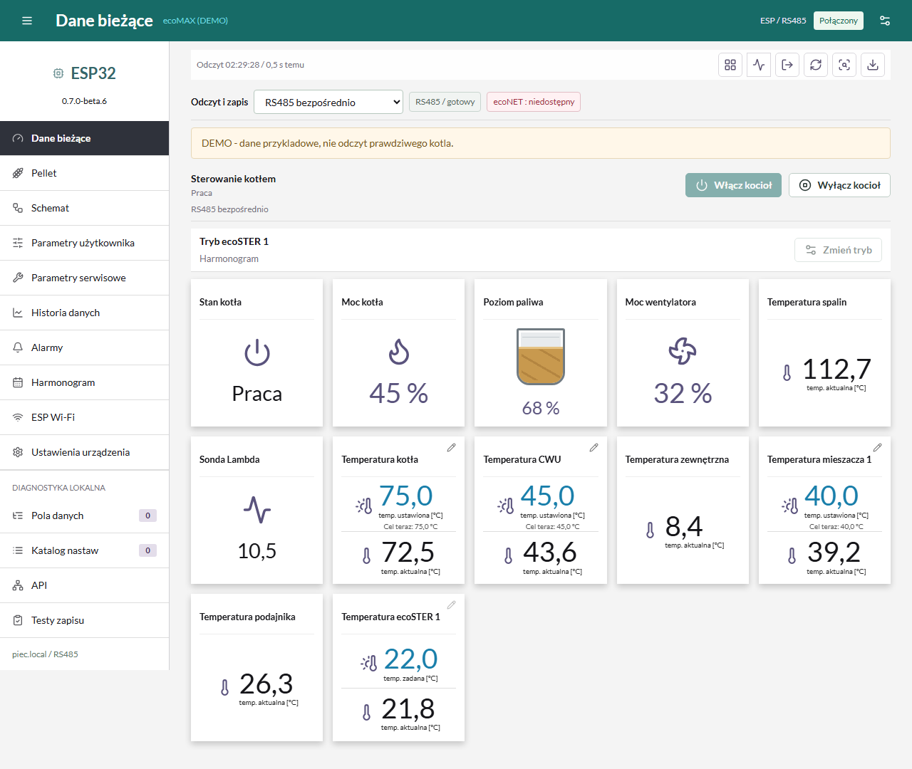
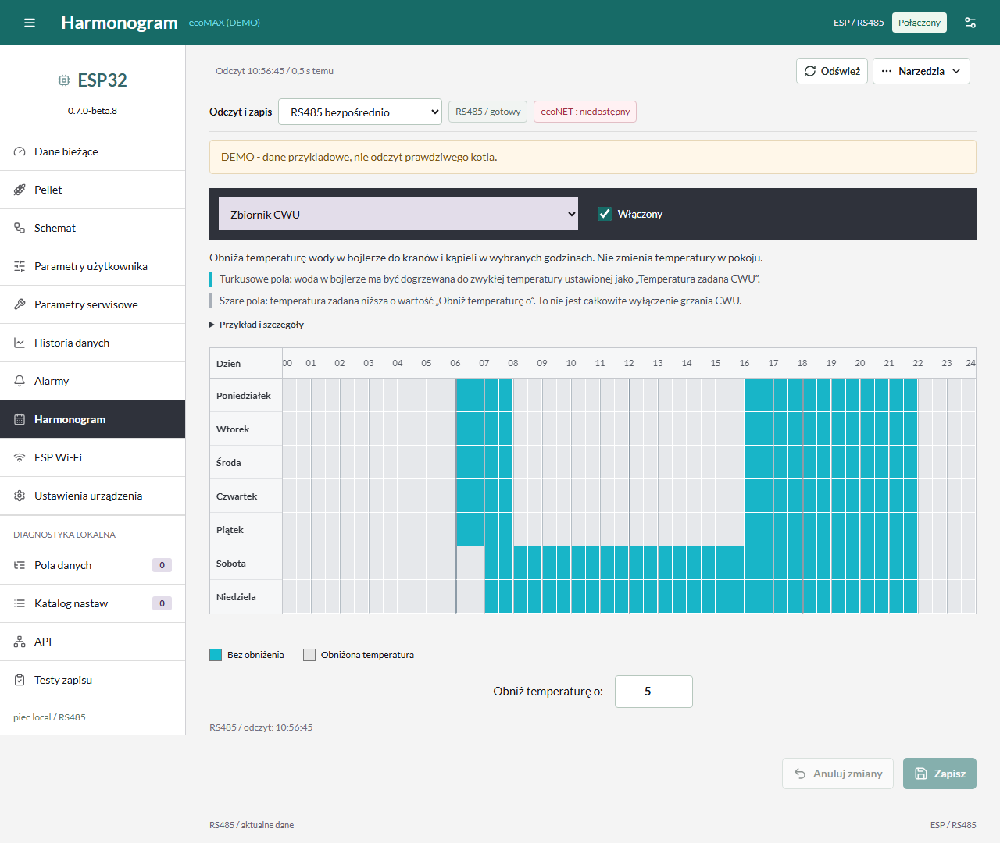
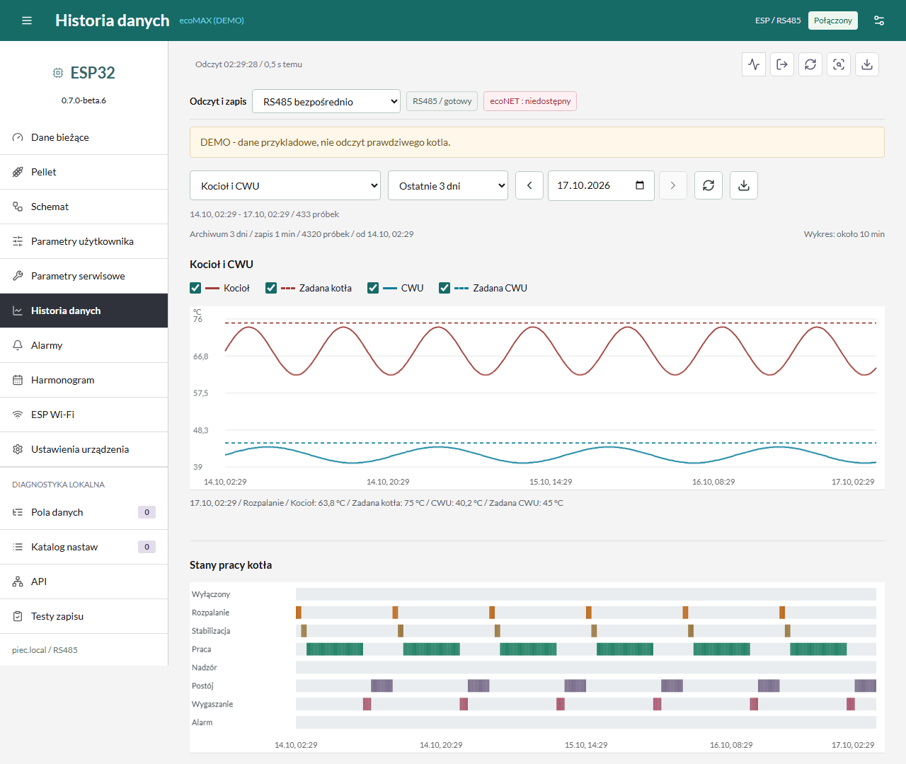
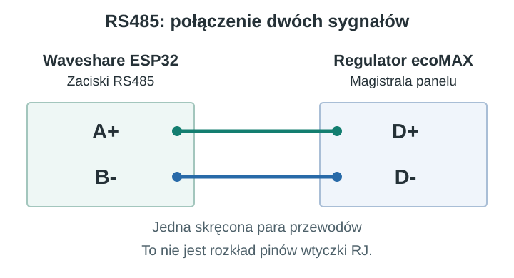
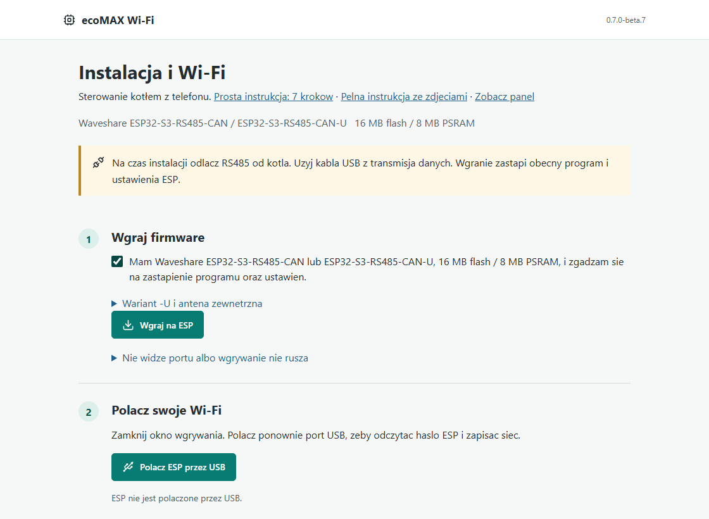

# ecoMAX RS485: lokalne sterowanie kotłem bez chmury

Lokalny panel kotla ecoMAX na ESP32: **RS485 lub lokalny ecoNET**, telefon/tablet,
nastawy, ecoSTER, harmonogramy, alarmy i historia pomiarow z ostatnich 3 dni.
Bez konta w chmurze do codziennej pracy. Interfejs i instrukcje po polsku.

**[Prosta instalacja w 7 krokach](docs/SZYBKI_START.md)** ·
**[Pobierz firmware i instrukcje](https://github.com/MareXcodemaster/ecomax-esp32-gateway/releases)**

**Wersja 0.7.0-beta.6. Projekt niezalezny, nieoficjalny. Nie jest produktem
PLUM ani Waveshare. Nie jest uniwersalnym firmware dla wszystkich
kotlow.** Nie omija zabezpieczen ani nie zastepuje regulatora kotla.

## Jak Wyglada Panel

### Harmonogram Tygodniowy

### Historia Temperatur I Pracy Kotla

**[Galeria: harmonogram, wykresy, stany kotla, zmiana nastawy i telefon](docs/GALERIA.md)**

Zrzuty przedstawiaja rzeczywisty interfejs z danymi przykladowymi (DEMO).

## Co Kupic I Jak Podlaczyc

**Waveshare ESP32-S3-RS485-CAN-U** to wariant z antena zewnetrzna SMA.
Wersja **ESP32-S3-RS485-CAN** ma domyslnie antene wbudowana.
Wymagane 16 MB flash / 8 MB PSRAM; ten sam obraz dla obu wariantow.

**[Zdjecia obu modeli, oznaczenia zaciskow i schemat G4](docs/SPRZET.md)**

Schemat dotyczy sygnalow A+/B- i D+/D-, nie numerow pinow dowolnej wtyczki.
G4 dotyczy wskazanego profilu regulatora, nie kazdego ecoMAX.
Prace wewnatrz kotla przy odlaczonym zasilaniu powierz instalatorowi.
Zdjecie jest ladowane ze strony Waveshare i nie jest objete MIT projektu.

## Zacznij Tutaj

**[Prosta instrukcja dla poczatkujacych: 7 krokow bez programowania](docs/SZYBKI_START.md)**

**[Polska instrukcja ze zdjeciami: od USB do sterowania kotlem](docs/START_PL.md)**

1. Przeczytaj [zgodnosc i ograniczenia](docs/ZGODNOSC.md).
2. Na komputerze otworz [instalator USB](https://marexcodemaster.github.io/ecomax-esp32-gateway/)
   w Chrome lub Edge. Podlacz plytke kablem USB z transmisja danych.
3. Potwierdz model **Waveshare ESP32-S3-RS485-CAN lub ESP32-S3-RS485-CAN-U,
   16 MB flash / 8 MB PSRAM** (wariant -U ma antene zewnetrzna),
   nacisnij **Wgraj na ESP** i wybierz port. Inne plytki nie sa objete wydaniem.
4. Zamknij okno wgrywania, nacisnij **Polacz ESP przez USB**, potem
   **Wyszukaj sieci**. Wybierz wlasne Wi-Fi 2,4 GHz i wpisz tylko haslo.
   Instalator odczyta haslo ESP i pokaze przycisk otwarcia panelu.
5. Dopiero potem, po bezpiecznym wylaczeniu zasilania kotla,
   wykonaj [polaczenie RS485](docs/PODLACZENIE.md).
6. Otworz `http://piec.local/` lub adres IP nadany ESP przez Twoj router.

Domyslna nazwe `piec.local` mozesz zmienic w zakladce **ESP Wi-Fi**,
np. na `kotlownia.local`. Zostaje zapamietana po restarcie.

Pierwsza instalacja wymaga komputera i kabla USB z transmisja danych.
Potem ESP dziala samodzielnie, a panel i OTA obsluzysz telefonem/tabletem.

Instalator nie wymaga Pythona ani edycji kodu. Wi-Fi mozna tez skonfigurowac
[telefonem przez siec ESP](docs/WIFI.md). Opcja zapasowa:
[paczka ZIP/BIN](https://github.com/MareXcodemaster/ecomax-esp32-gateway/releases)
i [instrukcja recznej instalacji](docs/INSTALACJA.md).
Instrukcje mozna tez otworzyc [bezposrednio przy instalatorze](https://marexcodemaster.github.io/ecomax-esp32-gateway/instrukcja.html).

## Sterowniki I Termostaty

Profil referencyjny: **ecoMAX860P-LZ TOUCH / modul ecoMAX860P4-LZ**,
oprogramowanie modulu A **8.41.38.L0**, panelu **8.30.28**,
termostat **eSTER_x40** w obserwowanym ukladzie parametrow.

**[Lista modeli, termostatow i status zgodnosci](docs/ZGODNOSC.md#sterowniki-lista-i-status)**
oddziela sprawdzony profil od modeli wymienianych przez inne integracje.
Posiadanie ecoNET nie gwarantuje pelnej obslugi tego panelu. Inne modele
i wersje wymagaja weryfikacji; nie omijaj blokad zapisu.

## Funkcje

| Funkcja | Zakres |
| --- | --- |
| Dane biezace | Tylko rzeczywiscie dostepne temperatury, stany i wyjscia |
| Nastawy | Odczyt, zakres i uprawnienia sprawdzane przed zapisem |
| ecoSTER | Profile temperatur pokojowych i tryby, jesli sterownik je udostepnia |
| Harmonogramy | Tydzien pn-nd, kratki po 30 minut, opisy dzialania i edycja |
| Alarmy | Licznik powiadomien i odczytywana historia, nie obejscie alarmow |
| Historia | 3 dni w flash, probki minutowe; dokladniejszy krotki bufor RAM |
| Pellet | Graficzny poziom i procent zglaszany przez sterownik, jesli dostepny |
| Polaczenia | RS485, HTTP do lokalnego ecoNET, tryb hybrydowy |
| OTA | Opcjonalne stabilne i beta z GitHuba, zawsze z recznym potwierdzeniem |

Szczegoly: [instrukcja panelu](docs/PANEL.md),
[bezpieczenstwo](SECURITY.md), [budowanie](docs/BUDOWANIE.md).

## Twoje Dane

Wi-Fi, haslo panelu i ustawienia sa przechowywane na Twoim ESP.
Do codziennego dzialania w domu nie potrzebujesz konta w chmurze.
Sprawdzanie nowych wersji na GitHubie jest opcjonalne; mozesz je wylaczyc.

Aktualizacje **nie sa wymagane** i nie instaluja sie samoczynnie. Kanal jest
modyfikowalny: **Stabilne i beta** albo **Tylko stabilne**. Beta jest
wyraznie oznaczona. Szczegoly i ograniczenia
migracji: [AKTUALIZACJE.md](docs/AKTUALIZACJE.md).

Nie wystawiaj panelu bezposrednio do Internetu. HTTP nie zapewnia szyfrowania;
zdalny dostep powinien byc realizowany przez VPN na routerze/bramce.

## Stan Wydania

Wydanie opiera sie na funkcjach poprzedniej wersji prywatnej. Publiczne
zmiany pierwszego startu, generowania hasla i przypisania nowego kotla
wymagaja jeszcze proby na drugiej, fabrycznie wyczyszczonej plytce.
Testy programowe i kompilacja nie zastepuja tego testu sprzetowego.

Licencja kodu projektu: [MIT](LICENSE). Zaleznosci zachowuja wlasne
licencje i atrybucje: [THIRD_PARTY.md](THIRD_PARTY.md).
