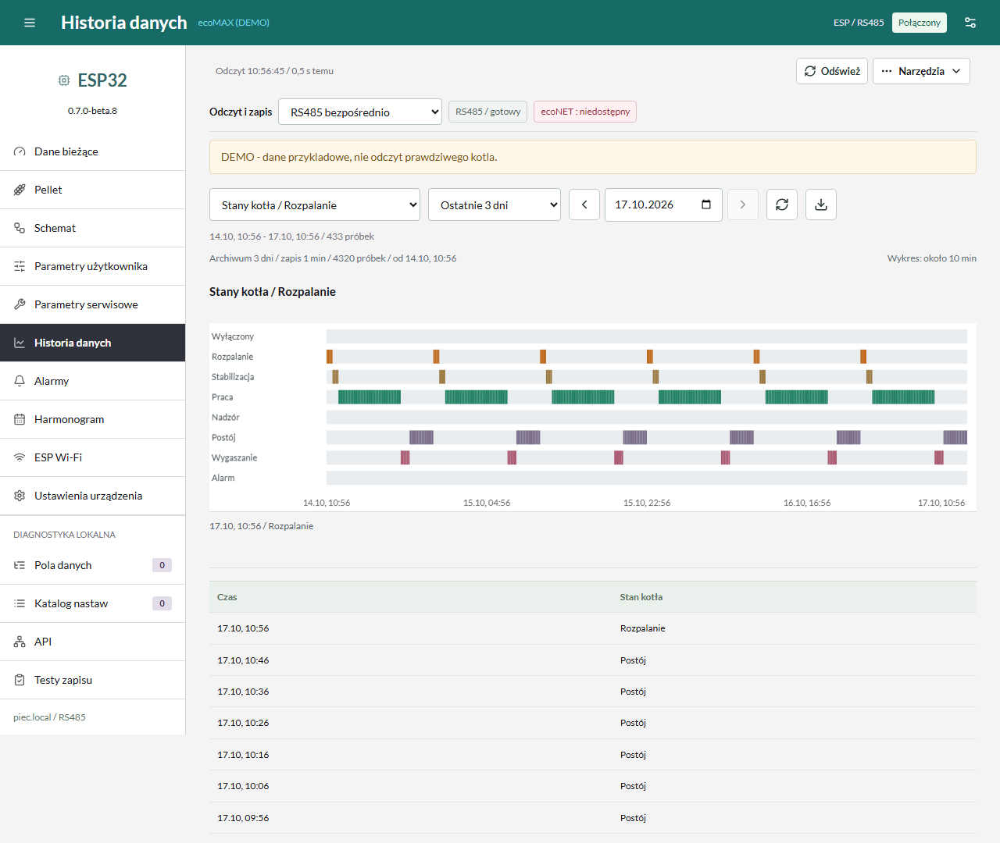
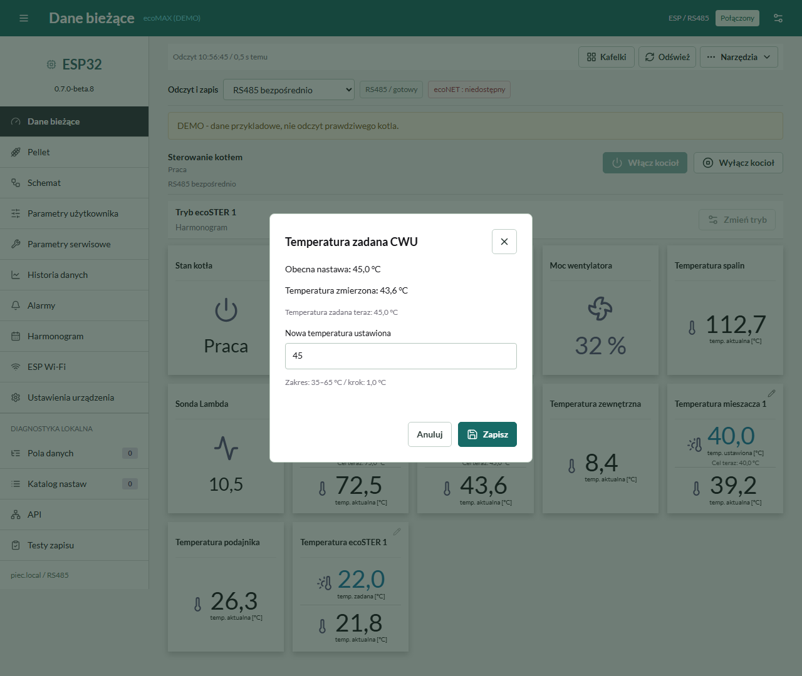
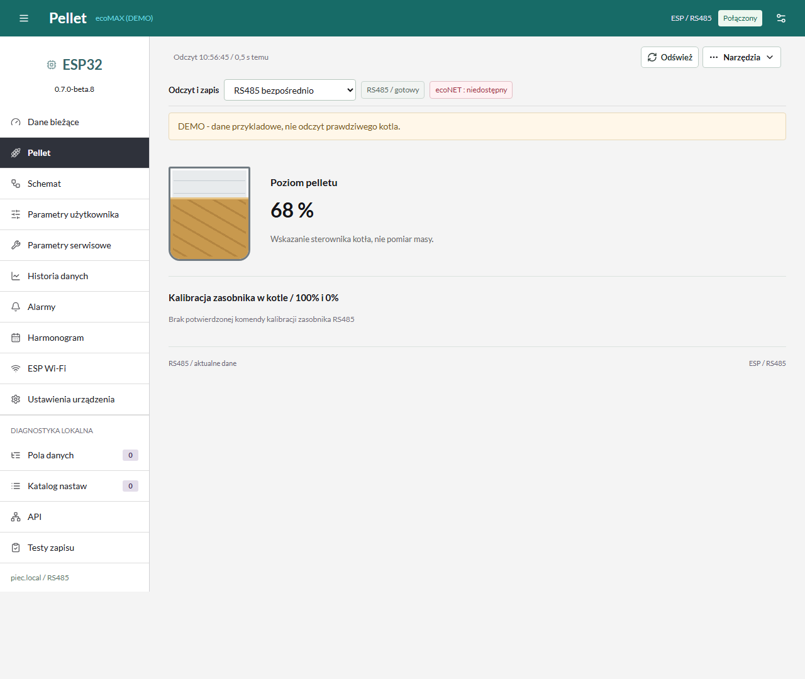
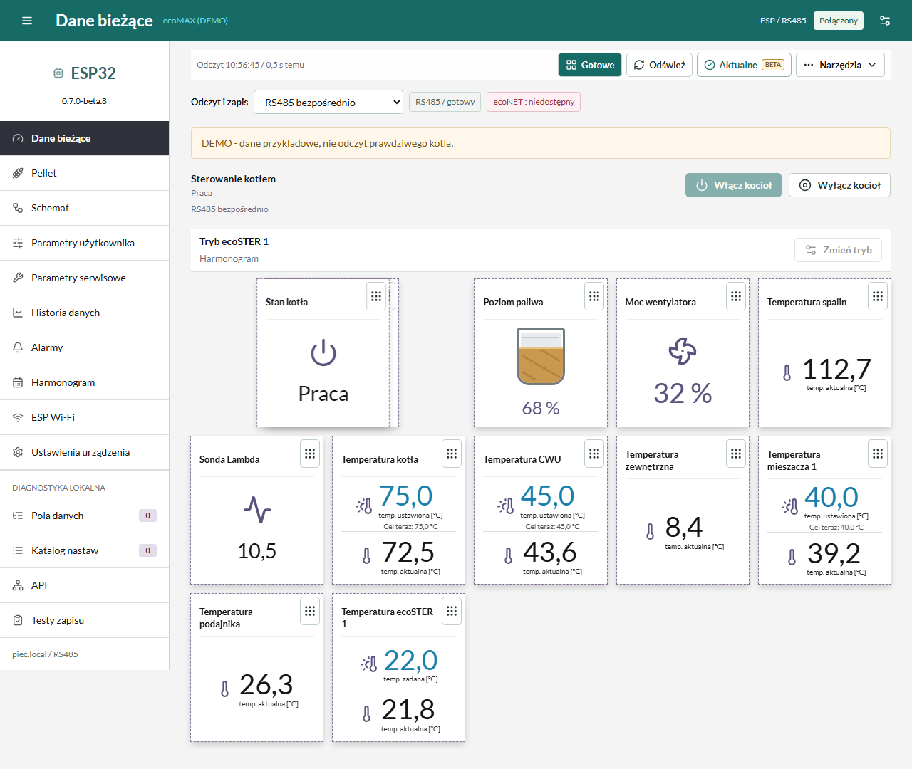
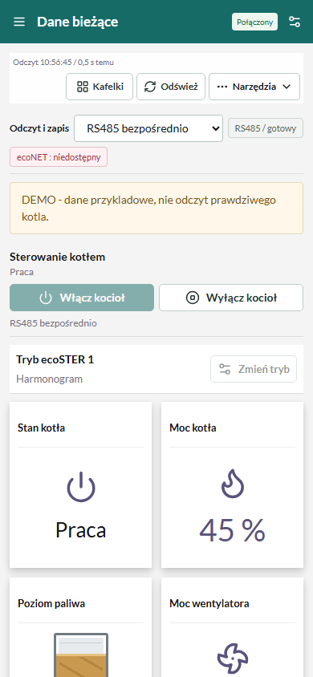
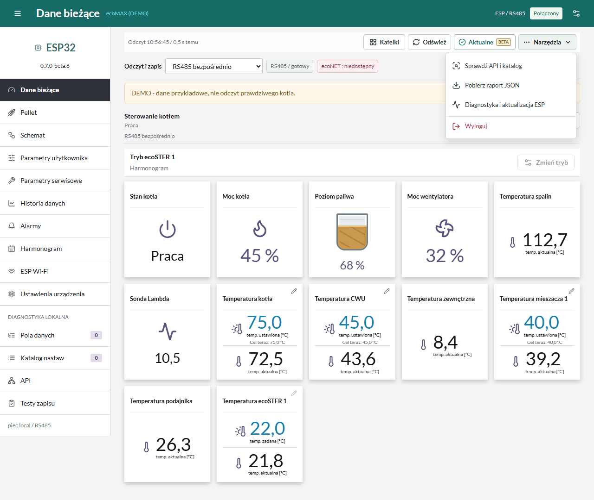

# Jak Wyglada Panel ecoMAX Wi-Fi

Zrzuty rzeczywistego interfejsu wersji **0.7.0-beta.8**, uruchomionego
lokalnie z **danymi przykladowymi (DEMO)**. Nie jest to potwierdzenie
obslugi kazdej nastawy w dowolnym kotle.
Kliknij zdjecie, aby je powiekszyc w GitHubie.

## Odczyty I Temperatury

Stan kotla, temperatury zmierzone i zadane, pokoj, mieszacz oraz poziom
paliwa, jezeli regulator udostepnia te dane.

## Harmonogram Tygodniowy

Dni od poniedzialku do niedzieli, godziny 00-24 i kratki po 30 minut.
Przy wybranym harmonogramie widac opis jego dzialania.

## Historia Temperatur

Wykresy temperatur i nastaw, wybor zakresu do 3 dni, stany pracy i CSV.
Pokazane przebiegi sa wygenerowanym przykladem.

## Rozpalanie I Stany Kotla

Osobny widok stanow: m.in. rozpalanie, stabilizacja, praca i wygaszanie.

## Zmiana Nastawy

Przykladowe okno zadanej temperatury CWU: wartosc zmierzona, obecna
nastawa, dopuszczalny zakres i zapis. Podczas robienia zdjecia nie
wysylano polecenia do zadnego kotla.

## Poziom Pelletu

Graficzny zasobnik z procentami z kotla. Brak danych nie oznacza 0%.

## Wlasna Kolejnosc Kafelkow

Przycisk edycji ukladu, przeciaganie myszka lub dotykiem i przywracanie
domyslnej kolejnosci. Kazda przegladarka zapamietuje wlasny uklad.

## Panel Na Telefonie

Ten sam panel na ekranie telefonu; menu boczne jest zwijane.

## Narzedzia Panelu

Podpisane przyciski Kafelki i Odswiez oraz menu z nazwami pozostalych funkcji.
Wyloguj jest ostatnia pozycja, oddzielona od narzedzi.

## Instalacja I Sprzet

Oba modele **Waveshare ESP32-S3-RS485-CAN** i **ESP32-S3-RS485-CAN-U**
(antena zewnetrzna) uzywaja tego samego firmware, 16 MB flash / 8 MB PSRAM.
Zobacz [instrukcje ze zdjeciami i schematem](START_PL.md),
[zgodnosc i ograniczenia](ZGODNOSC.md) oraz
[instalator USB](https://marexcodemaster.github.io/ecomax-esp32-gateway/).
