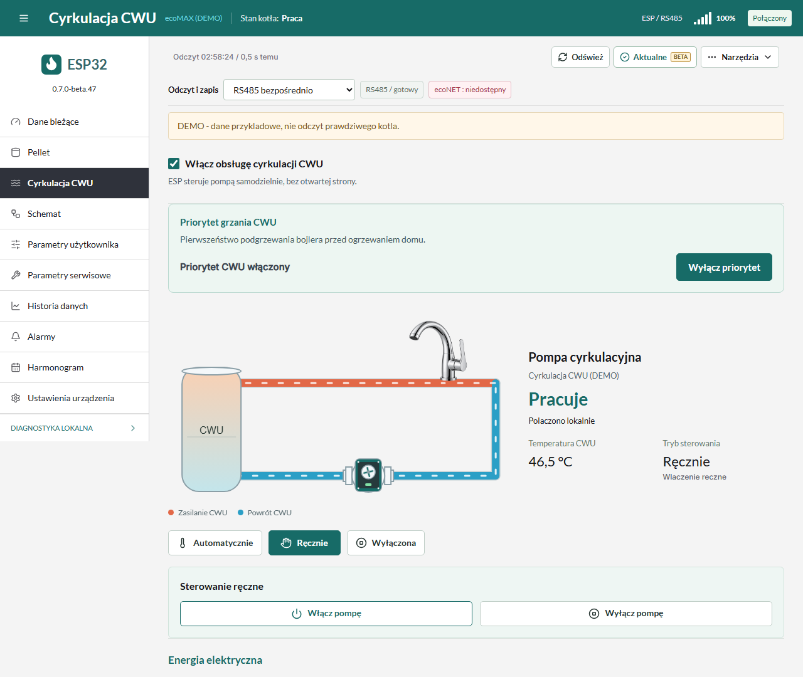
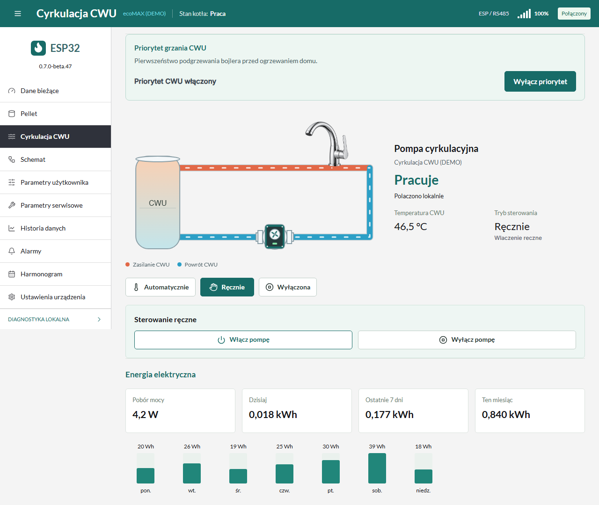

# Cyrkulacja CWU z gniazdkiem Tapo

Funkcja zewnetrznej cyrkulacji wody do kranow. Nie steruje pompa ladujaca
bojler, nie emuluje modulu C na magistrali PLUM i nie odblokowuje jego
pozostalych funkcji. Pierwsze wydanie jest testowe, domyslnie nieaktywne.

## Gniazdka

- **P110**: polaczenie TPAP i przelaczanie sprawdzane na rzeczywistym
  urzadzeniu; pozostale warianty sprzetu/firmware nadal wymagaja weryfikacji.
- **P100, P105, P110M, P115**: udostepnione wykrywanie i ten sam lokalny
  odczyt/zapis zasilania przez KLAP v2 lub TPAP. Nie testowano fizycznie
  wszystkich tych modeli. P100 nie potrzebuje pomiaru zuzycia energii.
- Podstawa protokolu: [biblioteka Tapo i jej lista modeli](https://github.com/mihai-dinculescu/tapo).
  Zgodnosc biblioteki nie jest gwarancja przetestowania tego firmware ESP.
- Starsze gniazdka udostepniajace tylko protokol AES, inne marki, kamery,
  zarowki i listwy wielogniazdowe nie sa obslugiwane. Sam adres IP nie
  wystarcza. Panel pokazuje odczytany model; przed przelaczeniem sprawdza
  zapisany MAC i identyfikator urzadzenia. Nie steruje dowolnym znalezionym
  urzadzeniem.

## Polaczenie

1. Skonfiguruj P110 w aplikacji Tapo i podlacz go do tej samej sieci LAN
   co ESP. Nie podlaczaj pompki do wyjscia kotla i gniazdka jednoczesnie.
   Sposob zasilania i obciazalnosc powinien potwierdzic instalator.
2. W panelu otworz **Cyrkulacja CWU** i zaznacz **Wlacz obsluge cyrkulacji CWU**.
   Nastepnie otworz **Polaczenie Tapo > Wyszukaj gniazdka**.
   Wybierz model, IP i MAC swojego gniazdka. Mozna tez wpisac lokalny IP.
3. Od beta.30 ESP automatycznie wykrywa **TPAP** i tworzy lokalna,
   szyfrowana sesje z potwierdzeniem znajomosci hasla po obu stronach.
   Przy dzialajacym TPAP nie trzeba wlaczac zgodnosci aplikacji innych firm.
   Starszy wariant KLAP v2 pozostaje obslugiwany, gdy gniazdko go udostepnia.
   Dostepnosc KLAP moze zalezec od opcji zgodnosci w Tapo; zmieniasz ja
   swiadomie samodzielnie. [Wyjasnienie producenta](https://www.tapo.com/uk/faqs/frequently-asked-questions-about-the-third-party-compatibility-feature/).
4. Wpisz dane konta Tapo tylko w lokalnym panelu, przez zaufana siec.
   Polaczenie z panelem jest HTTP, nie HTTPS. Haslo nie jest zwracane,
   eksportowane ani zapisywane w przegladarce przez aplikacje. ESP zapisuje
   lokalny odcisk uwierzytelniania KLAP i poswiadczenie TPAP password-shadow,
   nie haslo do konta; te odciski nadal
   sa tajnymi poswiadczeniami, a pamiec NVS nie jest szyfrowana.
5. **Polacz lokalnie** wykonuje odczyt, bez zmiany stanu gniazdka.
   Sprawdz nazwe i model przed zapisaniem trybu sterowania.

W TPAP pole e-mail jest opcjonalne; do KLAP potrzebny jest tez e-mail
konta. Po aktualizacji z beta.29 wpisz haslo jeden raz ponownie:
stary odcisk KLAP nie pozwala odtworzyc poswiadczenia TPAP. Nastepne
polaczenia i restarty nie wymagaja wpisywania hasla. Nie przesylaj go
autorowi projektu ani na GitHub.

Jesli gniazdko odrzuci haslo lub nie potwierdzi jego znajomosci,
ESP wstrzymuje kolejne proby logowania do czasu zapisania poprawnych
danych. Blokada jest zachowywana po restarcie. Nie ponawiaj logowania
wielokrotnie przy blednym hasle; P110 ma wlasne ograniczenie prob.

Beta.31 poprawia zachowanie jednego polaczenia HTTP podczas logowania.

Od beta.35 zmiana trybu, progow i harmonogramu zachowuje dzialajace
polaczenie z gniazdkiem. Po chwilowym bledzie ESP sam ponawia odczyt
i logowanie, bez ponownego wpisywania hasla. Gdy nie ma potwierdzenia,
panel pokazuje **Stan nieznany**, zamiast zgadywac ON lub OFF.
Aktualizacja z beta.30 zachowuje zapisane dane i blokade ponawiania
odrzuconego logowania. Po zapisaniu poprawnych danych panel zachowa
dokladny etap i kod ewentualnej odmowy. Aktualizacja i zwykly restart
nie ponawiaja automatycznie odrzuconych danych.

ESP zapamietuje MAC i skrot identyfikatora odczytanego po zalogowaniu.
Po utracie lacznosci wyszukuje ten sam MAC w swojej podsieci. Przed
kolejnym przelaczeniem ponownie sprawdza model, MAC i identyfikator.
Zmiana IP nie powinna wymagac ponownego parowania; izolacja klientow
Wi-Fi i rozne VLAN-y moga blokowac wyszukiwanie. Rezerwacja DHCP jest
dodatkowym, przydatnym zabezpieczeniem przed zmiana adresu.

## Proste sterowanie

Na gorze zakladki jest osobna sekcja **Priorytet grzania CWU** z przyciskiem
**Wylacz priorytet / Wlacz priorytet**. Dotyczy pierwszenstwa podgrzewania
bojlera przed CO. Wylaczenie priorytetu pozostawia grzanie CWU wlaczone.
Zmiana nie przelacza gniazdka Tapo ani nie zmienia progow i harmonogramu
cyrkulacji. Ta sama nastawa jest dostepna na kafelku Temperatura CWU.
Przycisk pojawia sie, gdy sterownik udostepnia odpowiednie tryby, i zapisuje
przez wybrany RS485 lub lokalny ecoNET. Zapis na kotle potwierdzono po RS485.

Wybierz **Automatycznie**, **Recznie** albo **Wylaczona**. Tryb zapisuje
sie od razu, bez dodatkowego Zapisz. **Wylaczona** zleca zatrzymanie pompy.

**Recznie** pokazuje osobne przyciski **Wlacz pompe** i **Wylacz pompe**.
Samo wybranie trybu zachowuje aktualny potwierdzony stan; przy stanie
nieznanym nie uruchamia pompy. Reczne wylaczenie pozostawia tryb Recznie.
Sterowanie reczne pomija progi i harmonogram, ale wlaczenie wymaga
aktualnego odczytu temperatury CWU. Zmiana trybu nie zapisuje szkicu
progów ani harmonogramu.

**Automatycznie** pokazuje od razu progi i opcje **Uzywaj harmonogramu**.
Po jej zaznaczeniu pojawia sie siatka godzin. Ustaw progi, opcjonalnie
zaznacz dni i godziny, a nastepnie **Zapisz i wlacz automatyke**.
Bez harmonogramu automatyka temperatury dziala przez cala dobe.

**Anuluj zmiany** pojawia sie tylko wtedy, gdy progi lub harmonogram
roznia sie od zapisanych. Znika po anulowaniu, zapisie i recznym
przywroceniu zapisanych wartosci. Samo odswiezenie danych go nie pokazuje.

Schemat pokazuje zbiornik CWU, cieple zasilanie, chlodniejszy powrot,
pompe i odgalezienie do realistycznego kranu w PNG. Niebieska rura
to powrot CWU, nie doplyw zimnej wody wodociagowej. Lekka animacja
SVG/CSS w rurach i pompie rusza po potwierdzonym wlaczeniu gniazdka.
Po wylaczeniu zatrzymuje sie; utrata odczytu oznacza **Stan nieznany**.
Kran jest symbolem punktu poboru: panel nie zna jego otwarcia.
Ruch w rurach obrazuje zasilanie pompy, nie pomiar przeplywu. W ESP nie
ma filmu ani odtwarzacza; pliki dzialaja lokalnie. Respektowane jest
ustawienie przegladarki ograniczajace ruch.

Funkcja jest opcjonalna i domyslnie wylaczona w nowej instalacji.
Aktualizacja zachowuje dzialanie wczesniej skonfigurowanego gniazdka.
Wylaczenie **obslugi cyrkulacji** zatrzymuje wysylanie polecen przez ESP,
ale nie zmienia stanu gniazdka. Jesli pompa ma sie zatrzymac, najpierw
wybierz **Wylaczona** i poczekaj na potwierdzenie, a potem wylacz obsluge.
Ponowne wlaczenie obslugi przywraca zapisany tryb, progi i harmonogram.

## Temperatury I Tryby

- **Automatycznie**: wlaczenie po osiagnieciu gornego progu CWU,
  wylaczenie po spadku do dolnego. Miedzy progami stan zapotrzebowania
  pozostaje zachowany. Przyklad: wlacz od 45 C, wylacz przy 40 C.
- Po starcie w srodku przedzialu ESP czeka na gorny prog zamiast wlaczac
  pompke na podstawie starego stanu. Progi sa ustawiane niezaleznie od
  temperatury zadanej CWU w kotle; zmiana nie zapisuje niczego do kotla.
- **Recznie**: wymuszenie pracy z pominieciem harmonogramu
  i progow, ale nadal wymaga aktualnego, poprawnego czujnika CWU.
- **Wylaczona**: polecenie wylaczenia gniazdka. Samo zapisanie pliku
  konfiguracji nie oznacza potwierdzonego przelaczenia.
- W trybie Auto przerwa po potwierdzonym wylaczeniu wynosi co najmniej
  30 sekund. Tryb **Recznie** pomija te przerwe; wylaczenie nie jest opozniane.
- Przed kazdym poleceniem i po nim odczytywany jest stan P110.
  Powtorzenie tego samego zadania HTTP nie zapisuje drugi raz konfiguracji.

## Pobor mocy i energia

P110, P110M i P115 moga udostepniac pomiar energii: **pobor mocy w W**,
**dzisiaj**, **ostatnie 7 dni** i **ten miesiac w kWh**. P100/P105 nie
maja tego pomiaru; sekcja jest ukryta i sterowanie nadal dziala.

Ostatnie 7 dni to szesc poprzednich dni kalendarzowych i dzisiaj do
ostatniego odczytu, wedlug czasu Europe/Warsaw. ESP czyta historie
z gniazdka, a dzisiejsza wartosc pobiera z jego aktualnego licznika.
Brakujace dane nie sa zamieniane na zera ani szacowane ze stalej mocy.
Niepelna historia oznacza Brak odczytu sumy 7 dni.

Moc/liczniki sa odczytywane co okolo 30 sekund, historia co 10 minut.
Odczyt jest dodatkowy: polecenie wlaczenia/wylaczenia ma pierwszenstwo.
Restart ESP nie kasuje historii zapisanej przez gniazdko. Starsze wersje
oprogramowania gniazdka moga nie udostepniac pelnej historii.

## Harmonogram

Opcja **Uzywaj harmonogramu** jest niezalezna od zapisanej siatki tygodnia.
Wylaczona: automatyka temperatury dziala przez cala dobe.
Wlaczona: automatyka moze uruchamiac pompke tylko w zaznaczonych polach.
Nie wymusza to ciaglej pracy; temperatura nadal musi na nia pozwalac.

Siatka jest od poniedzialku do niedzieli, w odcinkach po 30 minut.
Mozna malowac prostokat obejmujacy kilka dni i godzin. Pusta siatka
z wlaczonym harmonogramem oznacza brak godzin dozwolonej pracy.
Wylaczenie harmonogramu nie kasuje siatki. Zapis dotyczy tylko ESP.

Czas lokalny: Europe/Warsaw, z automatyczna zmiana lato/zima. ESP moze
otrzymac zegar z otwartego panelu; po restarcie probuje tez odczytac czas
z powiazanego P110. Jesli zaden zegar nie jest prawidlowy, harmonogram
nie uruchamia pompki. Po utracie zasilania wszystkich urzadzen i przy
braku internetu moze byc potrzebne otwarcie panelu, aby ustawic czas.

## Ograniczenia

- Wylacz kolidujace harmonogramy, tryb poza domem i automatyczne
  wylaczenie w aplikacji Tapo, jezeli zrodlem sterowania ma byc ESP.
  Oprogramowanie nie kasuje automatycznie Twoich ustawien w Tapo.
- Przy braku poprawnej temperatury CWU ESP zleca wylaczenie. Jezeli
  jednak P110 nie odpowiada, ESP nie moze fizycznie go wylaczyc:
  wyswietla **Stan nieznany**, a gniazdko moze pozostac wlaczone.
- Utrata zasilania ESP sama w sobie nie odcina zasilania P110.
  Ta funkcja nie jest zabezpieczeniem kotla i nie zastepuje instalacji
  elektrycznej ani zabezpieczen hydraulicznych producenta.
- Konto Tapo i urzadzenie musza zostac wczesniej skonfigurowane w aplikacji.
  Pozniejsze sterowanie odbywa sie bez chmury, ale wymaga dzialajacego LAN.
- Testy automatyki, kryptografii i formularza korzystaja z danych syntetycznych.
  Polaczenie TPAP oraz przelaczanie zweryfikowano tez na fizycznym P110.
  Rzeczywisty P110 nalezy sparowac i sprawdzic przed pozostawieniem
  automatyki bez nadzoru. Samo ACK nie jest potwierdzeniem pracy pompki.
