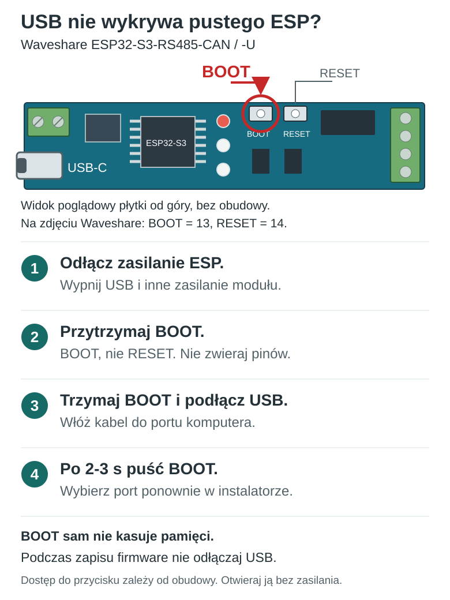
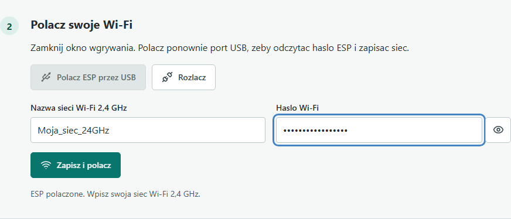
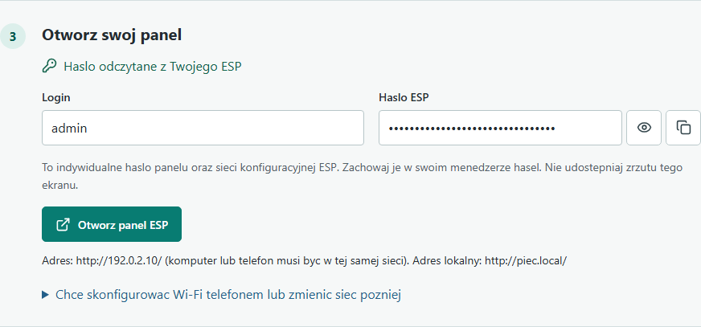
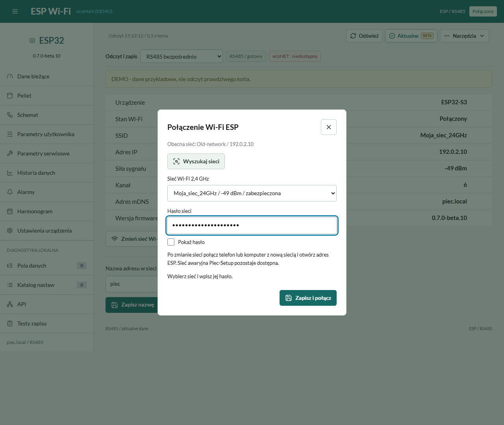
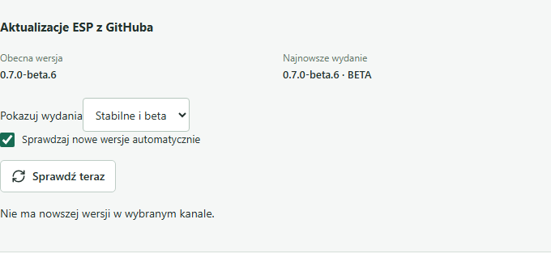

# ecoMAX Wi-Fi - sterowanie kotłem z telefonu

## Instrukcja krok po kroku

**Pierwszy raz z ESP? Zacznij od [prostej instrukcji w 7 krokach](SZYBKI_START.md).**

**Oprogramowanie: 0.7.0-beta.11. Instrukcja: wydanie 10, 17.10.2026.**

Projekt pozwala obsługiwać zgodny regulator kotła z telefonu, tabletu lub
komputera w domowej sieci. ESP32 odbiera dane i udostępnia własny panel.
Komputer i kabel USB są potrzebne do pierwszego wgrania. Później panel
działa przez Wi-Fi, także bez komputera i bez konta w chmurze.

**To wersja beta.** 17.10.2026 użytkownik potwierdził samodzielną instalację
według publicznej instrukcji, konfigurację i uruchomienie na swoim module
po pełnym wyczyszczeniu 16 MB flash. Nie jest to test drugiego egzemplarza
ani potwierdzenie wszystkich funkcji i kotłów PLUM. Zgodność pozostaje
ograniczona do wskazanego profilu.

Wygląd programu: [galeria panelu, harmonogramów i wykresów](GALERIA.md).
Zrzuty pokazują rzeczywisty interfejs z przykładowymi danymi DEMO.

## 1. Przygotuj właściwy sprzęt

**[Zdjęcia obu modeli, oznaczenia zacisków i schemat wpięcia do G4](SPRZET.md)**

Wariant z anteną zewnętrzną, **ESP32-S3-RS485-CAN-U**:

Wariant z anteną wbudowaną, **ESP32-S3-RS485-CAN**:

Zdjęcia Waveshare są ładowane od producenta, wymagają Internetu i nie są
objęte licencją MIT projektu. Sprawdź pełną nazwę i parametry oferty.

Potrzebujesz:

- **Waveshare ESP32-S3-RS485-CAN lub ESP32-S3-RS485-CAN-U,
  16 MB flash i 8 MB PSRAM.** Sam napis
  ESP32-S3 na innej płytce nie wystarcza.
- Kabla USB-C **z transmisją danych**, nie tylko do ładowania.
- Komputera z aktualnym Chrome albo Edge i dostępem do Internetu.
- Domowej sieci Wi-Fi **2,4 GHz**, jej nazwy oraz hasła.
- Do późniejszego podłączenia kotła: jednej skręconej pary przewodów
  sygnałowych i osobnego, prawidłowego zasilania ESP.

*Zdjęcie: Waveshare, [strona producenta](https://www.waveshare.com/esp32-s3-rs485-can.htm).
Zdjęcie jest ładowane z witryny producenta i wymaga Internetu; nie jest
objęte licencją MIT projektu. Pokazuje też opcjonalne złącze anteny.
Porównuj oznaczenia na swojej wersji urządzenia, nie sam wygląd obudowy.*

Na zdjęciu **Type-C** to USB-C. Na drugim końcu obudowy są osobne zaciski
**RS485: A+, B-** oraz **CAN: H, L**. Projekt nie używa zacisków CAN.
**Zaciski zasilania DC 7-36 V nie są zaciskami RS485.** Do pierwszej
konfiguracji wystarczy zasilanie z USB-C 5 V.

### Antena wbudowana i zewnętrzna: który model?

| Dokładny model Waveshare | Domyślna antena | Firmware |
| --- | --- | --- |
| **ESP32-S3-RS485-CAN** | Wbudowana na płytce | Ten sam obraz projektu |
| **ESP32-S3-RS485-CAN-U** | Zewnętrzna, złącze SMA na obudowie | Ten sam obraz projektu |

Wariant **-U jest właściwą wersją z fabrycznie aktywną anteną zewnętrzną**.
Przy wyłączonym zasilaniu podłącz do niego antenę Wi-Fi **2,4 GHz**,
a następnie uruchom urządzenie. Nie trzeba wybierać anteny w panelu,
zmieniać GPIO ani wgrywać osobnego programu. Umieść antenę poza metalową
obudową kotła, w bezpiecznej odległości od gorących elementów.

W wersji **bez -U** samo wpięcie anteny do wewnętrznego IPEX nie wystarczy:
producent opisuje **sprzętową zmianę położenia rezystora toru antenowego**.
Zleć tę drobną pracę lutowniczą serwisowi, przy odłączonym zasilaniu.
Program nie przełączy nieprzelutowanego toru. Jeżeli tor został już
prawidłowo przełączony, używaj tego samego firmware co dla -U.

Źródło: [porównanie obu modeli Waveshare](https://www.waveshare.com/esp32-s3-rs485-can.htm)
i [FAQ producenta: antena zewnętrzna](https://www.waveshare.com/wiki/ESP32-S3-RS485-CAN#FAQ).
**Zgodność -U wynika z dokumentacji wspólnej platformy, nie z osobnego
testu pierwszego uruchomienia publicznej bety na drugiej płytce.**
Sprawdź etykietę i pamięć własnego urządzenia; programu nie można użyć
do odczytania, jak fizycznie jest przełączona antena.

## 2. Najpierw skonfiguruj samo ESP, bez kotła

**Na czas wgrywania i pierwszej konfiguracji odłącz przewody RS485 od ESP.**
Nie rozkręcaj pracującego kotła. Jeżeli przewody są już podłączone wewnątrz
kotła, odłączenie powinien wykonać instalator po bezpiecznym odizolowaniu
zasilania urządzenia. W obudowie regulatora występuje 230 V.

1. Podłącz samo ESP do komputera kablem USB-C z transmisją danych.
2. Otwórz [instalator ecoMAX Wi-Fi](https://marexcodemaster.github.io/ecomax-esp32-gateway/)
   w **Chrome albo Edge na komputerze**. Przy pierwszym wgraniu nie używaj telefonu.
3. Przeczytaj ostrzeżenie i zaznacz potwierdzenie właściwej płytki.
4. Kliknij **Wgraj na ESP**.

*Zrzut własnego instalatora. Zaznaczenie zgody odblokowuje przycisk wgrywania.
Samo otwarcie strony nie wgrywa programu i nie zmienia ustawień.*

## 3. Wybierz port USB i wgraj program

1. W systemowym oknie wyboru zaznacz port odpowiadający podłączonej płytce.
   W Windows może to być np. **USB Serial Device (COM7)** albo urządzenie
   **USB JTAG/serial debug unit**. Nazwa i numer portu zależą od komputera.
2. Kliknij **Połącz / Connect** w oknie przeglądarki.
3. W oknie narzędzia wgrywającego wybierz instalację programu
   (**Install**) i potwierdź zastąpienie obecnej zawartości.
4. Poczekaj na komunikat zakończenia. **Nie odłączaj kabla podczas zapisu.**
5. Zamknij okno wgrywania, aby zwolniło port USB.

Pierwsza instalacja obrazu scalonego zastępuje program i obszar NVS z
ustawieniami ESP. Dotyczy to również sytuacji, gdy nie wybierzesz dodatkowego
kasowania całej pamięci. Nie wgrywaj tego obrazu na działającą instalację
tylko po to, aby zmienić nazwę domowej sieci.

**Nie widzisz portu?** Sprawdź inny kabel z transmisją danych i inny port USB.
Zamknij monitor portu, PlatformIO i inne aplikacje korzystające z ESP.

### Pusta pamięć: USB pojawia się i znika albo instalator ciągle łączy

Po pełnym wyczyszczeniu flash ESP może ciągle restartować się, przez co
komputer nie utrzymuje połączenia USB. W takim przypadku nie czekaj bez końca:

1. Odłącz USB oraz inne zasilanie **samego modułu ESP**. Przewody RS485 do kotła mają być odłączone.
2. Naciśnij i **trzymaj BOOT**, nie RESET.
3. **Trzymając BOOT, podłącz kabel USB do komputera.** Przycisk ma być wciśnięty już przed podłączeniem.
4. Po 2-3 sekundach puść BOOT. Ponownie wybierz port w instalatorze i rozpocznij wgrywanie.

Rysunek jest poglądowy. [Zdjęcie producenta z przyciskiem BOOT nr 13 i RESET nr 14](SPRZET.md#boot-usb).
Jeśli obudowa zasłania przyciski, dostęp do nich przygotuj przy całkowicie
odłączonym zasilaniu ESP. Nie wciskaj przypadkowych otworów ani nie zwieraj
pinów. Nie otwieraj w tym celu pracującego kotła.

BOOT wybiera tryb wgrywania; **sam nie kasuje pamięci**. Po wejściu w ten tryb
nie trzeba trzymać go przez cały zapis. Nie odłączaj USB podczas wgrywania.
Alternatywa przy już podłączonym USB: trzymaj BOOT, naciśnij i zwolnij RESET,
następnie puść BOOT. Po zakończeniu instalacji, jeśli program nie startuje,
naciśnij RESET bez trzymania BOOT.

Źródło: [Waveshare: oczekiwanie na połączenie i BOOT przy ponownym zasileniu](https://docs.waveshare.net/ESP32-S3-RS485-CAN/Firmware-Flashing/).

## 4. Zapisz swoją sieć Wi-Fi

1. Na tej samej stronie wybierz **Połącz ESP przez USB** i ponownie wskaż port.
2. Instalator odczyta dane dostepu. Domyslnie panel uzywa admin / admin.
3. Kliknij **Wyszukaj sieci** i wybierz swoje Wi-Fi **2,4 GHz** z listy.
4. Wpisz tylko hasło **domowego Wi-Fi** i kliknij **Zapisz i połącz**.
5. Zaczekaj na połączenie i przydzielenie adresu przez router.

*Zrzut demonstracyjny z symulowanego USB.
Nazwa „Moja_siec_24GHz” jest przykładem. Wybierz swoją sieć i wpisz jej hasło.
Ręczne wpisanie nazwy jest potrzebne tylko dla sieci ukrytych.*

Hasło Wi-Fi jest przekazywane **lokalnie przez USB do ESP**. Instalator
nie zapisuje go w przeglądarce.
Nie trzeba wpisywać poleceń, edytować kodu ani instalować Pythona.

Jeżeli po około minucie połączenia nadal nie ma, sprawdź nazwę, hasło,
zasięg i pasmo 2,4 GHz. Sieć gościnna z izolacją klientów może uniemożliwić
późniejsze otwarcie panelu. Poprawienie sieci nie wymaga ponownego wgrywania.

## 5. Otworz panel

| Polaczenie | Login | Haslo domyslne |
| --- | --- | --- |
| Panel ESP | admin | admin |
| Wi-Fi Piec-Setup-XXXX | nie dotyczy | piecwifi |

Hasla nie sa generowane losowo. Nie wpisuj tutaj hasla do domowego routera
ani konta ecoNET24. W **Ustawienia urzadzenia > Hasla dostepu** mozesz
zmienic oba hasla. Formularz wymaga obecnego hasla panelu i restartuje ESP
po zapisie. Zwykle aktualizacje zachowuja hasla wybrane przez uzytkownika.

1. Kliknij **Otworz panel ESP** i zaloguj sie jako **admin / admin**.
2. Telefon lub tablet podlacz do tej samej domowej sieci.
3. Otworz **http://piec.local/**. Gdy .local nie dziala, uzyj adresu IP
   pokazanego przez instalator lub router.
4. Dodaj strone do ekranu glownego lub zakladek.

Adres 192.0.2.10 na zrzucie jest przykladem. Twoje IP przydziela router.
Domyslne hasla sa publicznie znane. Nie przekierowuj portow ESP do Internetu.

### Własna nazwa zamiast piec.local

Domyślnie panel ma adres **http://piec.local/**. W **Narzędzia > Ustawienia ESP Wi-Fi**
wpisz nową nazwę adresu, np. **kotlownia**, i naciśnij **Zapisz nazwę**.
Następnie otwórz **http://kotlownia.local/**. Nie wpisuj całego adresu IP.
Dozwolone są litery a-z, cyfry i myślniki wewnątrz nazwy, maksymalnie 63 znaki.
Każde ESP w tej samej sieci powinno mieć inną nazwę.

Zmiana jest zapamiętywana i nie wymaga restartu ani rozłączenia Wi-Fi.
Adres IP nie zmienia się od tej operacji. Nazwa widoczna w tabeli DHCP routera
może odświeżyć się dopiero przy kolejnym połączeniu lub odnowieniu dzierżawy.
Gdy telefon/router nie obsługuje nazw .local, nadal można użyć adresu IP.

## 6. Alternatywnie ustaw Wi-Fi telefonem

Ten wariant jest przydatny, gdy konfigurujesz ESP blisko kotła, a nie przy komputerze.
Program musi byc juz wgrany. Domyslne haslo sieci Piec-Setup to piecwifi.

1. W telefonie otwórz ustawienia Wi-Fi i znajdź sieć **Piec-Setup-XXXX**.
   Końcówka jest zależna od konkretnej płytki.
2. Polacz sie, uzywajac domyslnego hasla **piecwifi** (lub wlasnego hasla tej sieci). Pozostań w tej sieci mimo ostrzeżenia
   telefonu o braku Internetu. Na czas konfiguracji możesz wyłączyć transmisję
   komórkową, jeżeli telefon sam ucieka do innego połączenia.
3. Otwórz **http://192.168.4.1/**.
4. Zaloguj sie jako **admin / admin** (lub wlasnym haslem panelu).
5. Wybierz **Narzędzia > Zmień sieć Wi-Fi**, kliknij **Wyszukaj sieci**, wybierz własną sieć 2,4 GHz,
   podaj jej hasło i zapisz.
6. Sprawdź uzyskany adres IP, przełącz telefon do swojej domowej sieci
   i otwórz panel ESP.

Późniejsza zmiana sieci: w panelu wybierz **Narzędzia > Zmień sieć Wi-Fi**.
Po zapisie ESP przełączy sieć. Połącz telefon z nową siecią i otwórz ponownie
`piec.local` lub własną nazwę ESP. W razie błędnego hasła pozostaje sieć Piec-Setup.
Zmiana nie wymaga diagnostyki ani kasowania pamięci.

**Montaż i zasięg:** moduł można umieścić na szynie DIN 35 mm w odpowiedniej
szafce automatyki, a antenę wyprowadzić poza metalową obudowę. Wariant -U
ma według producenta **SMA, nie RP-SMA**. Montaż w kotle tylko w bezpiecznej
strefie zgodnej z warunkami pracy urządzenia, przez instalatora.
Szczegóły: [szyna DIN, antena i dobór złącza](SPRZET.md#montaz-na-szynie-i-antena-poza-obudowa).
Nie trzeba ponownie wgrywać programu. Dokładniej: [konfiguracja Wi-Fi](WIFI.md).

## 7. Podłącz RS485 do zgodnego regulatora

**Ten etap powinien wykonać instalator.** Wyłącz i odizoluj zasilanie
kotła. Nie zmieniaj przewodów przy pracującym urządzeniu. Nie dotykaj
zacisków 230 V, STB, zabezpieczeń, palnika ani obwodów pomp.

Na sprawdzonej wersji **ecoMAX860P-LZ TOUCH / ecoMAX860P4-LZ** komunikacja
z panelem jest na magistrali **G4**. **G1 / M-BUS nie jest tym portem.**
Nie przenoś tego oznaczenia automatycznie na inne wersje regulatorów.

*To połączenie sygnałów, a nie rysunek kolejności pinów dowolnej wtyczki RJ.*

| Waveshare, zaciski RS485 | Regulator, potwierdzone sygnały magistrali panelu |
| --- | --- |
| A+ | D+ |
| B- | D- |

- Użyj jednej skręconej pary przewodów, np. pary ze skrętki UTP.
  Kolory są pomocnicze; liczą się oznaczenia sygnałów.
- **Nie wkładaj przypadkowego kabla Ethernet i nie zgaduj numerów pinów.**
  Wersje złączy i regulatorów mogą się różnić. Brak opisu D+/D- oznacza,
  że trzeba najpierw sprawdzić schemat konkretnej wersji u producenta.
- Zostaw ekran kotła i obecny termostat w ich prawidłowych połączeniach.
- Zasilaj ESP z USB-C 5 V albo dedykowanego wejścia DC 7-36 V zgodnie
  z dokumentacją Waveshare. Nie pobieraj zasilania z przypadkowych pinów G4.
- Nie łącz GND USB/ESP z PE ani przypadkowym zaciskiem kotła. Ewentualny
  przewód odniesienia musi mieć potwierdzone, właściwe zaciski po obu stronach.
- Przy dołączeniu do istniejącej, zakończonej magistrali pozostaw dodatkowy
  terminator 120 Ω na ESP wyłączony. Zakończenia należą do obu końców linii,
  a nie do każdego urządzenia.
- Zamknij obudowę, zanim przywrócisz zasilanie.

Więcej: [pełny opis podłączenia i konfliktu adresu](PODLACZENIE.md),
[dokumentacja Waveshare](https://www.waveshare.com/wiki/ESP32-S3-RS485-CAN).

## 8. Wybierz sposób komunikacji

| Tryb | Jak działa | Co z fizycznym ecoNET |
| --- | --- | --- |
| RS485 | ESP odczytuje i zapisuje przez magistralę kotła. | ecoNET nie może być aktywny na tej samej magistrali pod adresem 0x56. |
| ecoNET lokalny | ESP komunikuje się przez domową sieć z Twoim modułem ecoNET. | Moduł musi być zasilony i dostępny lokalnie. Chmura nie jest potrzebna. |
| Hybrydowy | Odczyt RS485 jest pasywny, zapis idzie przez lokalny ecoNET. | ecoNET pozostaje włączony. |

ESP w trybie aktywnym RS485 używa adresu **0x56 (86)**, takiego jak ecoNET.
**To adres magistrali, a nie adres IP Wi-Fi.** Dwa aktywne urządzenia
pod tym samym adresem mogą zakłócać komunikację. Nie obchodź blokady
nadawania przez ustawienie losowego adresu.

Tryb wybierasz listą **Odczyt i zapis**. Ikona koła zębatego przy stanie
połączenia otwiera dane modułu ecoNET. Dla ecoNET podaj jego **lokalny
adres, lokalny login i lokalne hasło**. To nie są dane konta ecoNET24.

## 9. Sprawdź, czy instalacja działa

1. Sprawdź, czy panel pokazuje połączenie, model regulatora i świeże odczyty.
2. Poczekaj na identyfikację i katalog. Przy pierwszym uruchomieniu może
   to potrwać kilkadziesiąt sekund. Samo Wi-Fi nie oznacza jeszcze komunikacji z kotłem.
3. Porównaj odczyt temperatury z ekranem regulatora. Nie traktuj pustego
   pola albo napisu „Brak odczytu” jako zera.
4. Nie odblokowuj na siłę edycji, jeśli program zgłasza inny model, UID,
   wersję katalogu albo konflikt na magistrali.
5. Zapis nastawy wykonuj raz i sprawdź wynik. „Niepotwierdzony” oznacza,
   że programu nie wolno traktować jako potwierdzenia zmiany na kotle.

ESP zapisuje lokalnie tożsamość pierwszego zgodnego regulatora. Zmiana
tożsamości lub niezgodny model blokują zapis. Przeczytaj
[zgodność i ograniczenia](ZGODNOSC.md) przed użyciem funkcji sterujących.

## 10. Codzienna obsługa z telefonu

| Zakładka | Do czego służy |
| --- | --- |
| Dane bieżące | Temperatury zmierzone, nastawy i rzeczywiste stany dostępne w regulatorze. |
| Parametry użytkownika | Odczyt i zmiana udostępnionych nastaw w dozwolonym zakresie. |
| Parametry serwisowe | Ustawienia wymagające znajomości kotła; nie zmieniaj ich eksperymentalnie. |
| Harmonogram | Tydzień od poniedziałku do niedzieli; jedna kratka to 30 minut. Obok jest opis działania wybranego harmonogramu. |
| Historia danych | Pomiary z maksymalnie ostatnich 3 dni. Historia zbiera się dopiero podczas pracy tej instalacji. |
| Alarmy | Powiadomienia i odczytywana historia zgłoszona przez regulator. |
| Pellet | Poziom udostępniony przez regulator i pozostałe dane diagnostyczne. Dwa puste kafelki strumienia i zużycia ESP pozostają usunięte. |
| Narzędzia > Ustawienia ESP Wi-Fi | Łączność samego ESP, własna nazwa .local. Dane ecoNET są osobne. |

Temperatura **zmierzona** to odczyt czujnika. Temperatura **zadana** to cel.
Harmonogram może zmieniać cel; nie zmienia w ten sposób odczytu czujnika.
Histereza to jeszcze inny parametr. Więcej: [instrukcja panelu](PANEL.md).

## 11. Aktualizacja bez komputera

### Z GitHuba, stabilne i beta

Otwórz **Ustawienia urządzenia → Aktualizacje ESP z GitHuba**.
ESP moze sprawdzac nowe wydania raz na dobe; mozesz wylaczyc te opcje
albo nacisnąć **Sprawdź teraz**. Sprawdzanie nie instaluje programu.

*Zrzut demonstracyjny wlasnego panelu, bez danych instalacji. Beta jest
wyraznie oznaczona jako wydanie testowe. Mozesz wybrac tylko stabilne.*

Gdy bedzie dostepna nowsza zgodna wersja w wybranym kanale, pojawi sie numer i przycisk
**Zaktualizuj**. Dopiero Twoje naciśnięcie i potwierdzenie restartu rozpoczynają
instalację. Możesz ją pominąć. Nie ma obowiązku aktualizacji.

Pobierany jest tylko obraz OTA z oficjalnego repozytorium. Program weryfikuje
HTTPS, SHA-256, wersję, projekt i rozmiar przed wybraniem nowego programu.
Nie ponawia automatycznie instalacji po błędzie. SHA-256 nie jest niezależnym
podpisem kryptograficznym. Szczegóły: [aktualizacje](AKTUALIZACJE.md).

**Stara instalacja prywatna nie jest automatycznie migrowana do publicznej.**
Taka droga wgrania jest zablokowana, aby nie utracić dostępu po zmianie
inicjalizacji haseł. Wymaga osobnej, potwierdzonej procedury.

### Ręcznie, ze zgodnego pliku OTA

1. Pobierz **firmware-ota.bin** ze zgodnego wydania w
   [Releases](https://github.com/MareXcodemaster/ecomax-esp32-gateway/releases).
2. Otwórz **http://piec.local/diagnostics** lub adres IP własnego ESP
   zakończony `/diagnostics` i zaloguj się hasłem ESP.
3. Wybierz plik w sekcji aktualizacji i wyślij go **jeden raz**.
4. Nie odłączaj zasilania. Zaczekaj na restart ESP i sprawdź wersję po powrocie panelu.

**firmware-merged.bin służy do pierwszej instalacji USB pod 0x0.
Nie używaj go jako obrazu OTA. firmware-ota.bin nie służy do wgrywania pod 0x0.**

Nieznany wynik aktualizacji: najpierw sprawdź dostępność i wersję,
zamiast wielokrotnie wysyłać ten sam plik. Przejście ze starej prywatnej
instalacji do publicznego pierwszego startu nie jest potwierdzoną ścieżką migracji.

## 12. Najczęstsze problemy

| Problem | Co sprawdzić |
| --- | --- |
| Przycisk wgrywania jest nieaktywny | Potwierdzenie modelu, Chrome/Edge na komputerze, HTTPS i brak zajętego portu USB. |
| Nie ma portu USB | Kabel z transmisją danych, inny port, BOOT/RESET; zamknij monitory portu. |
| Nie można ponownie połączyć USB | Zamknij okno wgrywania i inne programy korzystające z ESP. |
| ESP nie łączy się z Wi-Fi | Dokładna nazwa i hasło, 2,4 GHz, zasięg; nie wgrywaj programu ponownie. |
| piec.local nie działa | Użyj IP z instalatora/routera; sprawdź tę samą sieć i izolację klientów. |
| Panel działa, ale nie ma odczytów kotła | Osobno sprawdź RS485/ecoNET, właściwe sygnały, tryb, model i konflikt adresu. |
| Zapis nie jest potwierdzony | Odczytaj aktualną nastawę i stan połączenia; nie wysyłaj polecenia w pętli. |
| Brak wykresu sprzed instalacji | ESP nie pobiera starej historii z chmury. Historia zaczyna się lokalnie. |
| Brak części nastaw albo kalibracji zasobnika | Regulator może nie udostępniać tej funkcji lub zapis nie ma potwierdzonego mapowania. Nie wysyłaj losowych komend. |

Nie wystawiaj panelu HTTP bezpośrednio do Internetu. Do zdalnego dostępu
użyj VPN na routerze lub osobnej bramce. ESP nie wymaga chmury do działania
w domu. Nie publikuj zrzutów z hasłami, UID, numerami seryjnymi ani danymi własnej sieci.
