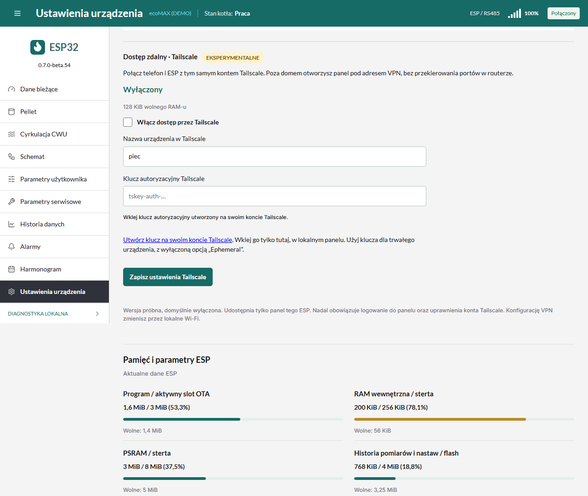

# Dostęp zdalny Tailscale na tym samym ESP

**Funkcja eksperymentalna od 0.7.0-beta.54, domyślnie wyłączona.** To integracja
społecznościowej biblioteki MicroLink, a nie oficjalny klient Tailscale.
W beta.54 potwierdzono załadowanie całego panelu i bieżących temperatur z telefonu
przez sieć komórkową i Tailscale. Pozostają dłuższe testy stabilności razem
z panelem, RS485, archiwum i gniazdkiem Tapo.

ESP z panelem oraz telefon dołączają do prywatnej sieci Tailscale użytkownika.
Nie jest potrzebny drugi komputer ani przekierowanie portów routera.
Oba urządzenia potrzebują dostępu do Internetu. Gdy połączenie bezpośrednie
jest niemożliwe, biblioteka może korzystać z szyfrowanego przekaźnika DERP.
Usługę koordynacji i przekaźniki zapewnia Tailscale; autor panelu nie prowadzi
własnego serwera i nie otrzymuje klucza użytkownika.

## Pierwsze połączenie

1. Zainstaluj oficjalną aplikację Tailscale na telefonie i zaloguj się na swoje
   konto. Włącz połączenie VPN w aplikacji.
2. Na tym samym koncie otwórz [klucze Tailscale](https://login.tailscale.com/admin/settings/keys)
   i utwórz **auth key**. Wyłącz opcję **Ephemeral**, ponieważ ESP ma pozostać
   zapisanym urządzeniem. Przy włączonym zatwierdzaniu urządzeń trzeba też
   zaakceptować ESP w konsoli Tailscale. Nie używaj hasła do konta ani API key.
3. Połącz się z domowym Wi-Fi i otwórz lokalny panel `http://piec.local/`.
   Wybierz **Ustawienia urządzenia → Dostęp zdalny · Tailscale**.
4. Włącz opcję, wpisz nazwę urządzenia (np. `piec`) i wklej klucz. Naciśnij
   **Zapisz ustawienia Tailscale**. Klucz podawaj wyłącznie w lokalnym panelu,
   nie w zgłoszeniu na GitHubie, zdjęciu ani wiadomości do autora.
5. Poczekaj na status **Połączono z Tailscale** i adres `http://100.x.x.x/`.
   Nadal obowiązuje login i hasło panelu ESP. Własne hasło panelu możesz ustawić
   w jego ustawieniach dostępu.
6. Na telefonie wyłącz Wi-Fi, pozostaw transmisję komórkową i Tailscale.
   Otwórz pokazany adres w przeglądarce. Jest to właściwy test dostępu spoza domu.
   Sam wpis ESP na liście urządzeń Tailscale nie potwierdza działania panelu.

Ta wersja używa klucza, a nie parowania kodem QR. `piec.local` pozostaje adresem
sieci lokalnej; do zdalnego testu użyj pokazanego adresu `100.x.x.x`.

## Co jest udostępnione

- Tylko panel HTTP tego ESP, port TCP 80, w szyfrowanym tunelu WireGuard.
- Logowanie panelu, ochrona poleceń i uprawnienia sieci Tailscale nadal obowiązują.
- Inne adresy domowe, most TCP RS485, ICMP/ping, IPv6 i pozostałe porty nie są
  udostępnione przez tę integrację. ESP nie jest routerem podsieci ani exit node.
- Sama konfiguracja Tailscale jest dostępna wyłącznie przez lokalne połączenie.
  Wyłączenie opcji zatrzymuje VPN; zapisane klucze zostają w ESP na kolejny raz.
- Puste pole klucza przy kolejnym zapisie zachowuje poprzedni klucz. API nie
  zwraca jego wartości. Konfiguracja i tożsamość urządzenia są zapisywane w NVS;
  fabryczne wymazanie całej pamięci je usuwa. NVS w tym firmware nie jest szyfrowane.

## Ograniczenia i pamięć

Wymagane: ESP32-S3, 16 MB flash, 8 MB PSRAM, zgodne z obsługiwanym Waveshare.
Biblioteka jest ustawiona na maksymalnie **16 peerów**. Katalog ma limit
16 znanych peerów, a komunikaty serwera i zasady dostępu są ograniczone rozmiarem.
Duża sieć firmowa lub nieobsługiwana reguła mogą uniemożliwić połączenie.
Nie usuwaj swoich reguł dostępu tylko po to, aby uruchomić wersję próbną.

Start wymaga co najmniej 112 KiB wolnego wewnętrznego RAM-u, bloku 16 KiB
i 2 MiB PSRAM, już po uruchomieniu zadania zarządzającego. Przy spadku zapasu
poniżej 48 KiB RAM-u lub 512 KiB PSRAM przez trzy kolejne odczyty VPN jest
zatrzymywany. Po awarii/watchdogu automatyczny start VPN jest wstrzymany;
można go ponownie uruchomić zapisując konfigurację lokalnie.
Te progi są zabezpieczeniem próby, a nie gwarancją stabilności.

Od beta.54 bufory sieci Wi-Fi i lwIP preferują PSRAM. Stosy zadań i bufory
wymagające DMA pozostają w pamięci wewnętrznej. Wyniki krótkich prób na
urządzeniu i testy pozostające do wykonania opisuje [raport testów](TAILNET_TESTY.md).

Przy nieudanym połączeniu przez trzy minuty próba jest zatrzymywana.
Po sprawdzeniu Internetu, klucza, zatwierdzenia urządzenia i reguł dostępu zapisz
ustawienia ponownie. Nie potrzeba do tego restartować kotła.
Stan „Oczekiwanie na synchronizację czasu” wymaga dostępu do serwera NTP;
poprawny czas jest konieczny do weryfikacji certyfikatów HTTPS.

Jeżeli po aktualizacji panel lokalny nie działa, przywróć poprzedni obraz OTA
przez dostępną diagnostykę lub instalator USB zgodnie z instrukcją aktualizacji.
Do pierwszego testu przygotuj poprzedni plik i miej dostęp do urządzenia.

Źródła: [ESP32 Tailnet Gateway](https://github.com/Mattboxx/esp32-tailnet-gateway),
[MicroLink](https://github.com/Mattboxx/microlink). Wersja źródeł i lokalne zmiany:
`components/microlink/UPSTREAM.json` i `components/microlink/ECOMAX_PATCHES.md`.
